# Multi-source Information Fusion! Feature Signal VMD Decomposition + CNN-Transformer for Fault Diagnosis Model!

Preface  
Multi-source Information Fusion for Rolling Bear Fault Diagnosis is a method that combines information from multiple sensors or signal sources to enhance the accuracy of fault detection and diagnosis. In the field of rolling bearing fault diagnosis, multi-source information fusion has been widely applied to improve diagnostic accuracy and robustness. Compared to traditional data layer fusion and feature layer fusion, this issue proposes a fault diagnosis model based on feature signal VMD decomposition and CNN-Transformer integration, further mining time-frequency features and enhancing time-series dependency modeling capabilities.
Building upon the previous two issues' collection of multi-source information fusion + fault diagnosis models:
1. Classical Convolutional Neural Network Fault Diagnosis Model Collection  
2. Multi-source Information Fusion + Classical Convolutional Neural Network Fault Diagnosis Model Collection  
3. Data Layer Fusion + Feature Layer Fusion Fault Diagnosis Model!  
Multi-source Information Fusion: Data Layer Fusion + Feature Layer Fusion Fault Diagnosis Model!  
This issue continues to update: A fault diagnosis model based on feature signal VMD decomposition + CNN-Transformer.  
(Suitable for signal classification tasks with multiple sensors and multiple features)  
Dataset: Southeast University Bear Fault Dataset  
Environment framework: Python 3.9, PyTorch 2.1 and above are all compatible  
Accuracy: Test set 100%  
Users: Those who need papers or graduation projects  
Code guarantee: Code comments are detailed and can be run successfully without modification.
Model Process Overview  
1.1 Multi-source Feature Signal VMD Decomposition
For multi-source fault vibration signals, the Variational Mode Decomposition (VMD) is first applied to decompose the raw feature signal into multiple modes. This process effectively separates complex signals into several Intrinsic Mode Functions (IMFs), capturing the local time-frequency characteristics of the signal. Additionally, VMD has good noise suppression capabilities, providing a more pure and discriminative input for subsequent feature extraction.
1.2 Integration of CNN-Transformer for feature extraction
Based on the multimodal signals obtained from VMD decomposition, a deep learning architecture that integrates Convolutional Neural Network (CNN) and Transformer is designed:
The CNN module utilizes 1D convolution to capture the local temporal features of time series signals, automatically extracting multi-level representations of the signals.
The Transformer module is based on self-attention mechanisms, capable of capturing long-range dependencies and global temporal dynamics in signals, thereby addressing the limitations of CNNs in modeling global information.
Finally, the multi-scale time-frequency features extracted by CNN and Transformer are fused, and then input into a fully connected layer to complete fault classification.
2. Preprocessing of multi-source bearing fault data
2.1 Import Data
Southeast University dataset is mainly divided into bearing dataset and gearbox dataset, with each fault type corresponding to these two working conditions (speed 20Hz (1200rpm) - load 0V(0Nm) and speed 30Hz (1800rpm) - load 2V(7.32Nm)), which are respectively represented by the grateset and bearingset folders. The bearing dataset includes five types:
\tRoller fault (Ball fault)
Inner ring fault
\tOuter ring fault
\t Combination fault on both inner ring and outer ring
Normal operation (Health working state)
We will discuss preprocessing with the 5-class bearing dataset, which has 8 channels.
\t  
2.2 VMD Decomposition and Preprocessing
Decomposition Visualization:
Due to the large volume of data, for a portion of the data and four channels, we created a dataset using sliding windows. We then evenly divided the dataset into training sets, validation sets, and test sets in a 7:2:1 ratio. Finally, we saved the data. The distribution of the dataset after partitioning is as follows:
\t  
3. Fault Diagnosis Model Based on CNN-Transformer Feature Fusion
3.1 Set parameters and train the model
50 epochs, accuracy 100%, using VMD+CNN-Transformer feature fusion for network classification, significantly improves performance. It can extract important features from multi-source fault signal characteristics, achieving noticeable results!
3.2 Model Evaluation
(1) Accuracy, Precision, Recall, F1 Score
(2) Fault 5 Classification Confusion Matrix:
(3) Classification Label Visualization
(4) Original Data t-SNE Feature Visualization
(5) t-SNE feature visualization after model training:
Click to download: Complete original data, Python code
Multi-source Information Fusion + Multi-Scale Convolution MSCNN-BiGRU Parallel Fault Diagnosis Model!
Preface
1. Multi-source Information Fusion Technology
Through the integration of data from different sensors, and combined with data mining and deep learning methods, it improves the precision and stability of fault diagnosis. Deep Neural Networks (DNN) in particular Convolutional Neural Networks (CNN) and Recurrent Neural Networks (RNN) demonstrate strong feature learning and pattern recognition capabilities in the field of time-series signal processing. Multi-scale Convolutional Neural Networks (MSCNN) extract rich spatial features through different scale convolutional kernels, capturing both local and global information in signals. By integrating Bidirectional Gated Recurrent Units (BiGRU), further temporal dependencies are mined. Based on this, this paper proposes a parallel fusion model based on Python for MSCNN-BiGRU to efficiently extract features and fuse classification for multi-source vibration signals.

2. Building upon the previous four-part collection of multi-source information fusion + fault diagnosis models:
 (1)Classical Convolutional Neural Network fault diagnosis model collection
Multi-source Information Fusion + Classical Convolutional Neural Network fault diagnosis model collection
 (2)Data layer fusion + feature layer fusion fault diagnosis model!
Multi-source Information Fusion: Data layer fusion + feature layer fusion fault diagnosis model!
 (3)Multi-source Information Fusion: Based on feature signal VMD decomposition + CNN-Transformer fault diagnosis model!
Multi-source Information Fusion: Data layer fusion + feature layer fusion fault diagnosis model!

3. This period continues to update: Fault diagnosis model based on MSCNN-BiGRU parallelism.
 (Suitable for signal classification tasks involving multiple sensors and multiple features)
● Dataset: Southeast University bearing fault dataset
● Environment framework: python 3.9, pytorch 2.1 and above versions can run
● Accuracy: Test set 99%
● Use cases: Paper requirements, graduation design requirements
● Code guarantee: Code comments detailed, ready to run without modification.
1.1 Increased Model Video Tutorial:
Added detailed video tutorials, which provide an in-depth explanation, suitable for beginners to learn multi-source information fusion fault diagnosis series models! New model parameter introduction!

1.2 PyCharm Code Update:
We strictly follow the complete GitHub - Pytorch deep learning project structure and rewrote the code to facilitate learning and cultivate a standard coding habit! If you need to write open source code for future papers, you can also refactor the code!

2 Preprocessing of Multi-Source Bearing Fault Data:
2.1 Import Data:
The Southeast University dataset is divided into bearing datasets and gearbox datasets, with each fault type corresponding to these two working conditions (speed 20Hz (1200rpm) - load 0V(0Nm) and speed 30Hz(1800rpm) - load 2V(7.32Nm)), respectively corresponding to the gearset and bearingset folders. The bearing dataset (5 types):
- Rolling ball fault (Ball fault)
- Inner ring fault (Inner ring fault)
- Outer ring fault (Outer ring fault)
- Combination fault on both inner ring and outer ring
- Normal working state (Healthy working state)
We will explain the preprocessing of the 5-class bearing dataset, with a dataset of 8 channels!
2.2 Data Preprocessing:
By creating datasets through sliding windows and uniformly dividing the training set, validation set, and test set by 7:2:1, we finally save the data. The distribution of the completed dataset is as follows:
3 MSCNN-BiGRU Parallel Model Introduction:
3.1 Model Introduction
(1) Multi-source Information Fusion Framework
(2) Multi-Scale Convolutional Neural Network (MSCNN)
(3) Bidirectional Gated Recurrent Unit (BiGRU)
(4) MSCNN and BiGRU Parallel Fusion Structure
3.2 Set parameters and train the model
\t50 epochs, accuracy rate of 99.85%, the MSCNN-BiGRU network has a significant effect in classification. It can extract important features from fault signal characteristics for model recognition, and the effect is obvious!
3.3 Model Evaluation
(1) Accuracy, Precision, Recall, F1 Score
(2) Fault 5 Classification Confusion Matrix:
Click to download: Complete original data, Python code
Previously Featured Content:
Speedy Paper | 2D-SWinTransformer+1D-CNN-SENet Parallel Fault Diagnosis Model
Bearing Life Prediction Major Update! New Collection of CNN-BiGRU-Attention Models + Rich Visualization Charts
Multimodal - Fault Diagnosis | Large Core Convolution Opens a New Era in Vision!
Superior! Direct Writing in Zone One! Fault Diagnosis Model Based on SSA+Informer-SENet
Fault Diagnosis Model with Multisource Information Integration: Data Layer Integration + Feature Layer Integration!
Gearbox Fault Diagnosis: Multimodal Innovation Model Based on MTF+Swin-Informer
Bearing Signal Fault Diagnosis Model Based on Multiscale Convolutional Neural Network (MSCNN-1D)
! Bearing Fault Diagnosis Model Based on CNN-BiLSTM-KAN Model
Rolling Bear Remaining Service Life Prediction
34 Classic Bearing Fault Diagnosis Models Collection | The King of Price-Performance Online
Feature Extraction + Probabilistic Neural Network PNN Bearing Signal Fault Diagnosis Model
High Innovation! Fault Diagnosis Model Based on FFT+WDCNN-Transformer Time-Frequency Domain Fusion
END
2. Friends who like this can click to follow, give the article a "like", share on WeChat Moments or discuss groups

## Images

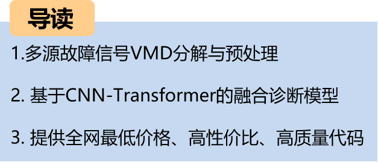
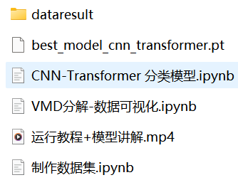
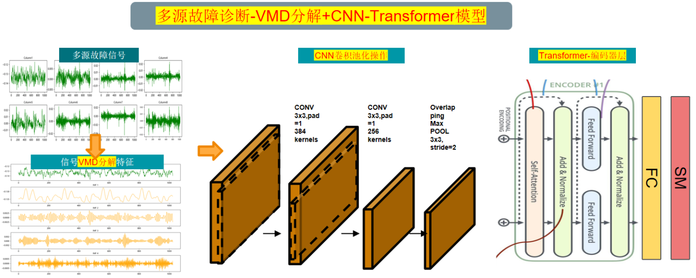
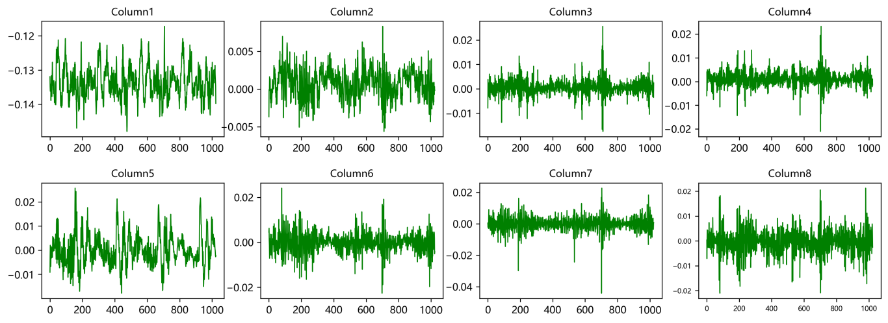
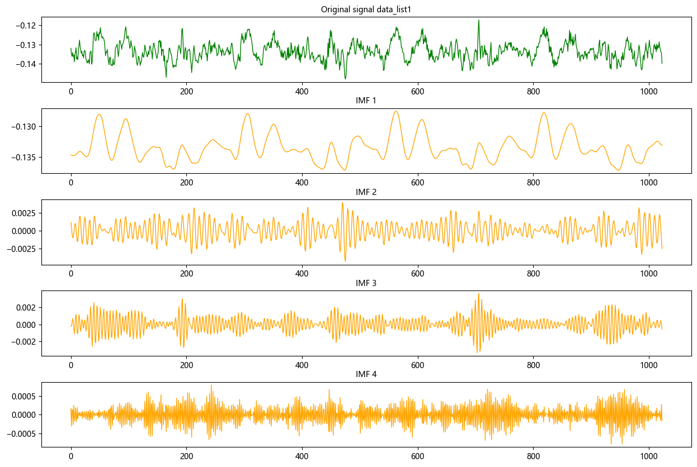
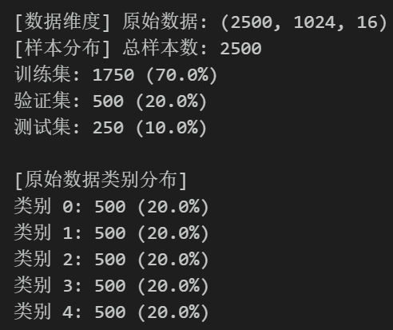
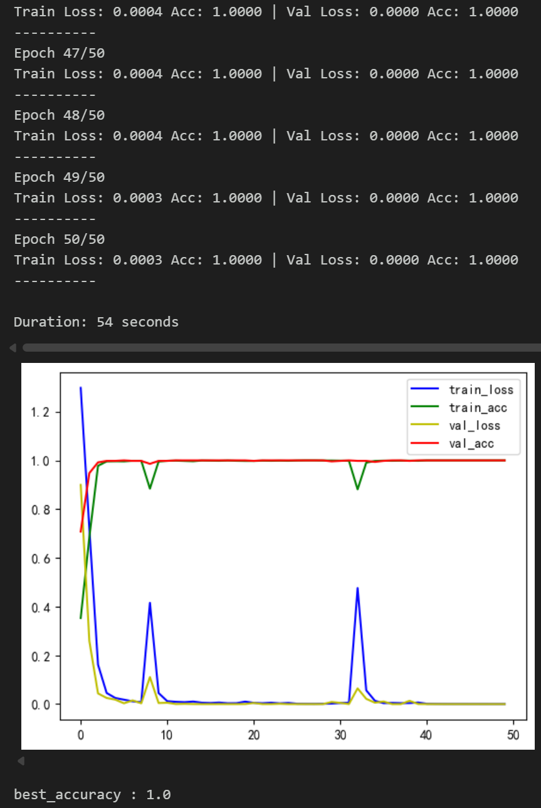
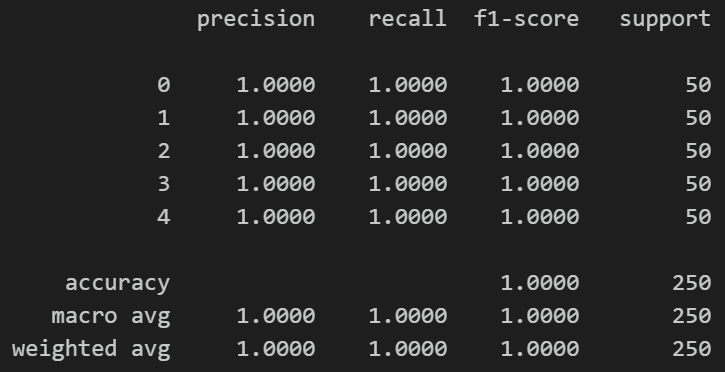
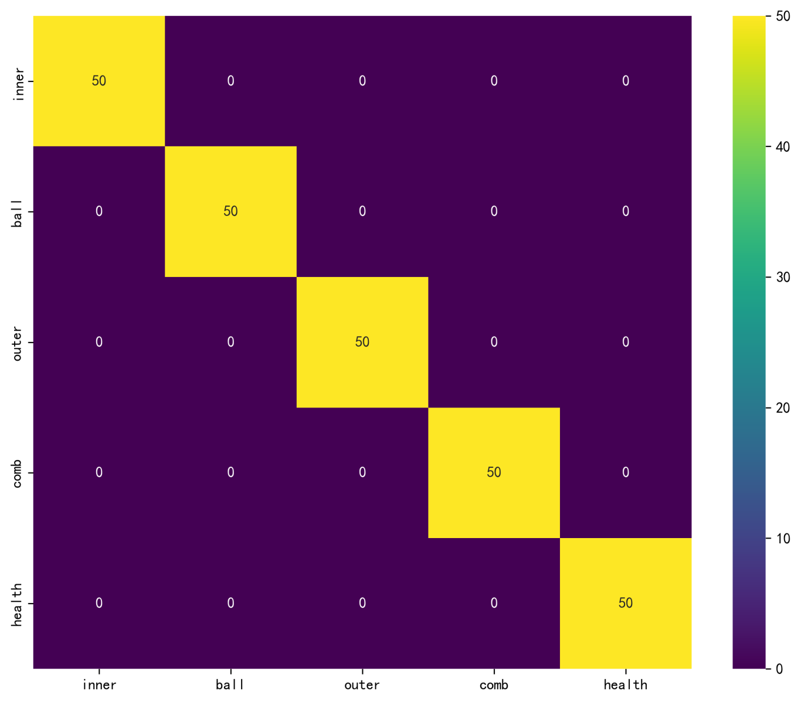
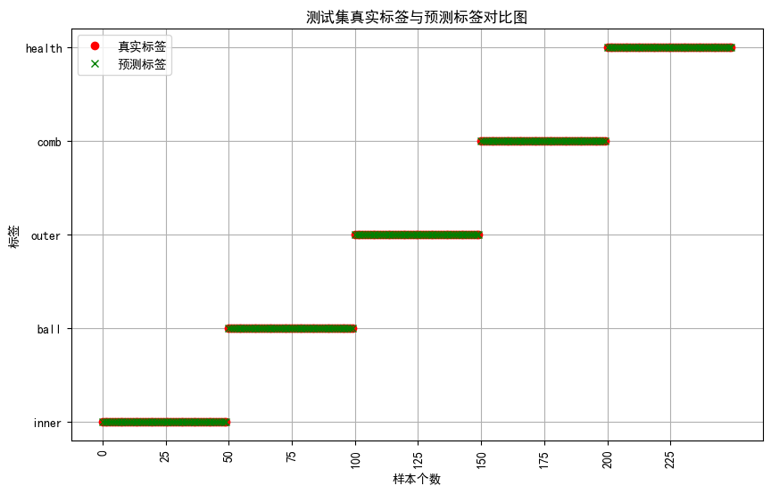
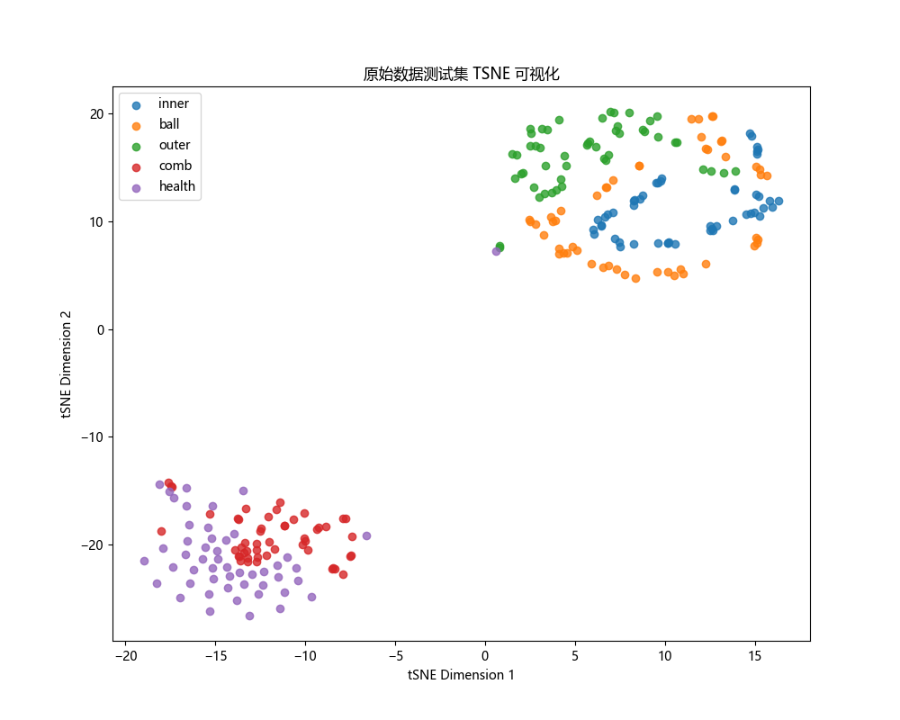
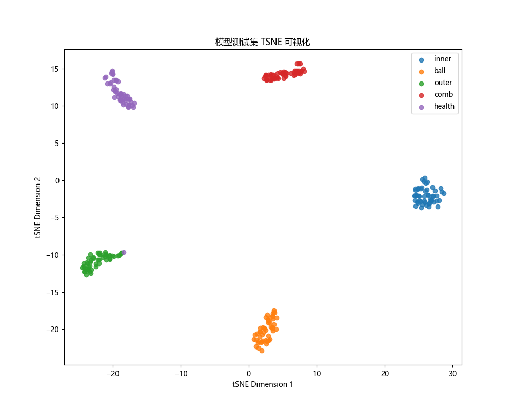

<!-- PAYMENT_BLOCK -->

## Get this dataset

- Payment link (Stripe): [Buy now](https://buy.stripe.com/3cs8yP7sY87d0vu9AB)
- Payment QR code: 

<!-- /PAYMENT_BLOCK -->
